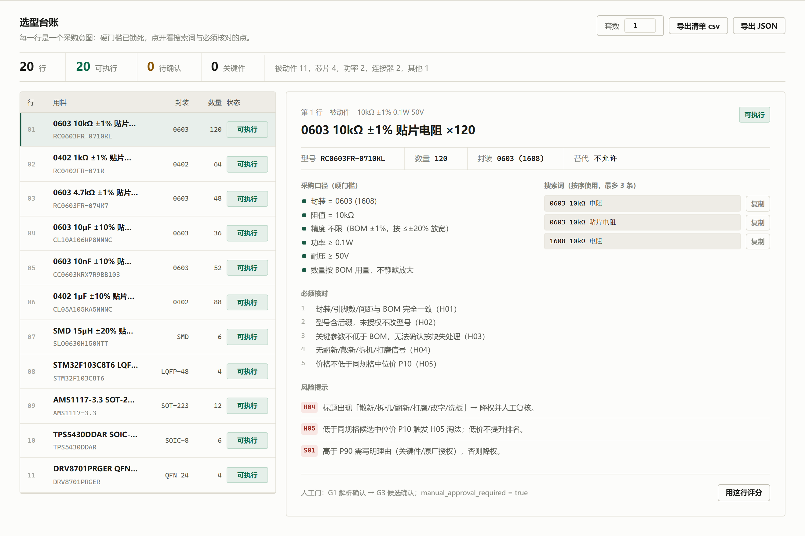

# BOM 采购台（bom-procurement）

**专给嘉立创 EDA 导出的 BOM 用的采购台。** 嘉立创专业版 / 标准版导出的 CSV、XLSX 原样拖进来就行——
不用改表头、不用编列、不用把 `C46749` 抄到别的表格里；程序先拿**立创编号**换回权威规格，
再到本机已登录的淘宝里逐行比价、选 SKU、加进购物车。

**购物车是终点。** 结算、付款、地址、发票永远由你本人在淘宝里完成。

**v0.13.8** · Windows 10 / 11 · 界面跑在 `127.0.0.1:8765`，BOM 与登录态不出本机

> **合规声明**
>
> 本项目是个人自用的采购辅助工具：不代登录、不读取或导出 Cookie、不自动结算付款。
> 撞到**滑块**时会先尝试自动完成（本地识别 + 模拟拖动，需可选组件，见 [验证与风控](#验证与风控)）——
> 这属于自动通过站点的人机校验，**可能违反目标网站服务条款，也可能加严风控**；
> **图片点选、人脸、短信验证一律不自动处理**，只等你手动完成。
> 自动化访问风险自负，请自行确认合法合规后再使用。

---

## 下载

不用克隆仓库，直接下压缩包：

| 下载 | 大小 | 适合谁 |
|---|---|---|
| **[免安装便携版](https://github.com/zyx781/bom-procurement/releases/download/v0.13.8/BOM-Procurement-v0.13.8-portable.zip)** | 52 MB | 电脑没装 Python —— 解压双击就能用，推荐 |
| **[标准版](https://github.com/zyx781/bom-procurement/releases/download/v0.13.8/BOM-Procurement-v0.13.8.zip)** | 1.7 MB | 已经装了 Python 3.10 或更高版本 |

- 所有版本与更新记录：[Releases](https://github.com/zyx781/bom-procurement/releases)
- 校验值：[SHA256SUMS.txt](https://github.com/zyx781/bom-procurement/releases/download/v0.13.8/SHA256SUMS.txt)
- 三步上手：解压 → 双击 `启动BOM选型台.bat` → 跟着浏览器里的向导走（详见包内 `使用说明.md`）
- 系统要求：Windows 10 / 11，Microsoft Edge（系统自带）

---

## 它能做什么 / 不能做什么

| 能做 | 不做 |
|---|---|
| 直接吃嘉立创 EDA 导出的 CSV / XLSX（带标题行、多工作表、合并单元格都行），认 `Supplier Part`、`Comment`、`Footprint` 等列 | 不代你登录，不保存或上传账号密码 |
| 按规则选型：硬门槛、容差分档、介电质（C0G/X7R）、连接器系列、尺寸与耐压 | 不破解图片点选 / 人脸 / 短信验证；滑块只做「自动拖 → 刷新 → 停下等你」 |
| 淘宝搜索候选并按规则打分，挑最贴合的一家 | 不自动结算、付款、填地址、开发票 |
| 自动选 SKU、设置数量、加入购物车，并三态确认（页面提示 / 角标 / 加购接口） | 不保证一定买到：无合格候选、限流、库存不足都会如实报告 |
| 同一份 BOM 断点续跑、撞验证按「自动滑块 → 刷新 → 人工」三级恢复、限流时自动降温 | 不做多账号、不做代理池、不做指纹伪装 |
| 被动件同店合并，按「料钱 + 新店运费」选店，省重复运费 | 不替代你判断：型号对不对、要不要买，最终由你决定 |
| 批量结束导出逐行结果 CSV（Excel 直接打开）、一键导出脱敏诊断包 | — |

## 截图



上传 BOM 后逐行给出采购口径、搜索词与必须核对的点。左栏是台账（行号、用料、封装、数量、状态），右栏是选中行的完整判断依据。截图用的是仓库内的示例 BOM，不含任何真实订单或价格。

---

## 快速开始

### 1. 环境

- Windows 10 / 11（64 位）+ Microsoft Edge
- Python 3.10+ —— **只有标准版需要**；便携版自带运行时与依赖

```bash
# 标准版 / 源码运行
pip install -r requirements.txt

# 想跑测试和静态检查（ruff + mypy）
pip install -r requirements-dev.txt

# 想在撞验证时自动拖滑块（可选，约 100 MB）
pip install -r requirements-optional.txt
```

### 2. 启动

```text
启动BOM选型台.bat      ← 自检 → 后台起服务 → 打开界面（会自动拉起调试版 Edge）
```

只有一种情况需要手动先开浏览器：你想自己确认 CDP 端口。那就先跑 `打开调试版Edge.bat`。

启动器挑解释器的顺序：**包内自带运行时**（`runtime\python`，便携版才有）→ 根目录 `.venv`
（`安装环境.bat` 建的，会先验证真能跑，拷来的坏 venv 会跳过）→ 系统 PATH 里依赖齐全的 Python。

`.bat` 只是薄入口，逻辑都在 [`bom-site/launcher.ps1`](bom-site/launcher.ps1)：Python / 依赖 / Edge 自检、端口冲突检查、后台起服务、健康检查、CDP 就绪探测。服务用 `pythonw.exe` 跑，不留黑框。

| 命令 | 作用 |
|---|---|
| `启动BOM选型台.bat` | 启动（已在运行就直接打开界面） |
| `启动BOM选型台.bat status` | 只看运行状态，不启动任何东西 |
| `启动BOM选型台.bat diag` | 只读体检：Python / 依赖 / Edge / 端口 / PID / 日志 |
| `启动BOM选型台.bat stop` | 停服务 + 关调试版 Edge（普通 Edge 不动） |
| `启动BOM选型台.bat restart` | 重启服务（改了 `server.py` / `taobao_runner.py` 必须用它） |
| `启动BOM选型台.bat help` | 打印用法 |

> **Python 服务不会热重载。** 改完代码不重启，页面还是旧逻辑——这是「改了没生效」最常见的原因。

也可以手动起服务（等价，但没有自检）：

```bash
cd bom-site
python server.py            # 默认 127.0.0.1:8765
```

### 3. 跑一遍

1. 上传 BOM（CSV / XLSX），确认行数与警告；「套数」会按倍数放大所有用量
2. 点 **启动淘宝会话**；未登录就在弹出的窗口里扫码
3. 点 **一键全部加购**（或选中某行只跑这一行）
4. 跑完看逐行状态，去淘宝核对购物车，自己结算

浏览器里始终只有**一个淘宝窗口**：会话在这个窗口里登录、搜索、加购，不会再冒出一个空白「新建标签页」。

---

## 嘉立创 EDA 导出的 BOM 怎么传

从嘉立创 EDA（专业版 / 标准版）直接导出 CSV 或 XLSX 就能传，**不用改表头**——中英文列名都认。
导出文件里带标题行、多个工作表、合并单元格，也都能处理。

### 认的列

| 嘉立创列名（别名都认） | 程序用途 | 重要度 |
|---|---|---|
| `Supplier Part` / `供应商编号` / `立创编号` | **权威身份**：`C` + 数字（如 `C46749`），据此回查型号、封装、阻值/容值、耐压、精度 | 强烈建议 |
| `Comment` / `名称` / `器件名称` / `值` | 设计值（如 `10kΩ`、`100nF`、`32.768kHz`） | 三者至少一个 |
| `Manufacturer Part` / `型号` / `料号` | 完整型号，用于搜索词与标题核对 | 同上 |
| `Footprint` / `封装` | 封装门禁（0402 ≠ 0603、SOP-8 ≠ SOIC-8） | 建议 |
| `Quantity` / `数量` | 用量；页面「套数」会再乘一次 | **必须有** |
| `Designator` / `位号` | 判品类（R/C/L/U/J）、识别同族、拆双排排针 | 建议 |
| `Supplier` / `供应商` | 仅作展示 | 可选 |

> 表头不必一字不差：`供应商料号`、`立创料号`、`LCSC Part #`、`part number`、`Qty` 等写法都能识别。
> 完整别名表在 [`bom-site/engine.py`](bom-site/engine.py) 的 `HEADER_ALIASES`。

### 编号优先，冲突不猜

- **编号是唯一标识**：分析时先拿 `C` 编号去立创换权威规格，第一条搜索词直接用编号对应型号
  （如 `CC1H103ZA1ED3F4D1100 瓷片电容`），标题命中型号的候选优先；
- **型号列与编号不一致（`V02`）**：以编号型号为准，并在行上提示你核对；
- **名称列的设计值与编号规格冲突（`V01`）**：说明这份 BOM 自相矛盾（名称写 470Ω、编号却是 1kΩ 的那颗料）。
  这时**不给搜索词、不会自动买**，交你核对原理图——除非型号列本身被多行复用（说明那型号不是这颗料的），
  才仍按名称列买并留痕；
- 编号填 `无` / `-` / `N/A`：按「没有编号」处理，走型号精确匹配（型号完全一致才认，模糊命中一律放弃）。

### 几个常见坑

| 现象 | 原因 / 处理 |
|---|---|
| 少了几行 | 多工作表时，表头与本表对不上的页会被跳过并在警告里点名；把它单独另存一份再传 |
| 表头没识别 | 表头不必在第一行（前 10 行里找命中最多的一行），但必须含「型号 / 名称 / 参数」之一 |
| 立创编号查不到 | 断网或编号不存在：设 `LCSC_OFFLINE=1` 只用本地缓存；否则退回按型号/参数核对，结果标「同规格替代」 |
| 数量是 0 或空 | 这一行会被标「数量缺失或不是正整数」，不会静默按 1 颗买 |
| 要按 5 套备料 | 不用改 BOM：页面「套数」填 5，所有行按 5 倍下单 |
| 名称写 `NC` / 不贴装 | 判定为「不需要采购」，即使料号栏有残留编号也不会买 |

---

## 验证与风控

撞到验证时按**三级**处理，顺序不能反：

| 级 | 动作 | 说明 |
|---|---|---|
| 1 | **自动拖滑块** | 需可选组件（`ddddocr` / `opencv-python`）。两种形态都认：拼图（geetest）用 ddddocr 找缺口 + 轮廓检测兜底；阿里 nc（`#nc_1_n1z`）量轨道宽度拖到最右。默认开 |
| 2 | **刷新自恢复** | 第 1 级没拖过，或遇到 `_____tmd_____` 中间页：重载页面再数商品卡，数得出来就原地继续，**不惊动人、不挂 30 分钟** |
| 3 | **停下等人工** | 前两级都不行才 `VERIFICATION_REQUIRED`：批量暂停、页面顶部挂提示条（含倒计时），默认最多等 30 分钟；你过完点「验证已完成，重新检测」，2–3 秒内自动解除 |

顺序为什么不能反：**先刷新会把这张滑块换成新的一张**，等于白丢一次机会。

### 自动滑块（可选）

```bash
pip install -r requirements-optional.txt   # ddddocr + opencv-python
```

不装也能跑完整流程，只是滑块一律走「刷新 → 人工」。

| 变量 | 默认 | 作用 |
|---|---|---|
| `TAOBAO_SLIDER_SOLVE` | `1` | 设 `0` 关掉自动过滑块 |
| `TAOBAO_SLIDER_TRIES` | `2` | 单次撞验证最多拖几次（失败会换一张图再试） |
| `TAOBAO_SLIDER_MAX_PER_SESSION` | `30` | 一个会话的总次数上限，防止死循环把风控逼急 |
| `TAOBAO_SLIDER_SECONDS` | `45` | 单次求解的时间预算（秒） |

> 自动过验证属于绕过站点的人机校验，**有被加严风控的风险**。如果发现滑块出现频率明显上升，先调慢 `speed`（`settings.json`），别一味加次数。

### 明确不做的

- **图片点选**（点文字/图序）、**人脸**、**短信验证**：没有自动路径，只走「刷新 → 人工」
- 不接第三方打码平台
- 不改指纹、不挂代理、不改频率去规避风控，不做多账号

---

## 规则是怎么定的

规则细节全部在 [`skills/bom-procurement/SKILL.md`](skills/bom-procurement/SKILL.md)，核心几条：

| 规则 | 作用 |
|---|---|
| 硬门槛（封装、针数、间距、容值/阻值、耐压、沟道…） | 不一致直接否决，不靠总分侥幸通过 |
| 容差分档 | 宽于要求按倍数降分；精密档（≤0.5%）超 3 倍直接否决 |
| 介电质门禁 | 要 C0G/NP0 却给 X7R/X5R → 否决；未标注 → 降权 + 人工核对提示 |
| 连接器系列 | XH ≠ KF2510 ≠ PH；KF128 与 2EDG 视为同族 |
| 尺寸 / 体积 | 电解电容、电感按封装和 MPN 提取尺寸，超 1.35 倍否决（参数对但装不上） |
| 立创编号锚定 | 有 `Supplier Part`（如 `C46749`）就先拿编号换权威规格，第一条搜索词用编号对应型号；名称列与编号规格冲突时**不自动买**，交人工 |
| 加购确认 | 页面提示 / 角标 +1 / **加购接口 2xx** 三选一；都没有就查购物车定夺 |
| 收尾对账 | 跑完把每个 ok 行跟购物车实际行比对（按料号/封装/阻容值等规格原子），找不到就降级并记录；整批都对不上时判「读车异常」，不逐行降级 |
| 三道钱闸门 | 每只单价异常、单行金额超 `max_line_cost`、数量超量：任一命中就不买。**演练与真跑走同一套闸门** |

### 省运费：同店合并

被动件（电阻 / 电容 / 电感 / 磁珠 / 保险丝 / 晶振）选店时，把**本批已经买过的店**往前排：

> 有效花费 = 这行的料钱 + （这家店还没买过 ？ 一次运费 ： 0）

- 同店贵几毛，会赢「新店便宜几毛」；同店贵一大截，照样买便宜的——合并是为了省钱，不是为了合并；
- **只调「先开哪家」**，硬门槛、规格核实、SKU 核实一条不少；
- IC / 连接器不动（单价高、型号唯一，为省几块跑偏不值当）；
- 跑完进度条会写：`货在 3 家店（14 行），预计运费 ¥18，同店合并省了约 ¥66`；
- 店名读不到时不参与合并，行为与改前完全一样，并会明说「同店合并这次没生效」。

两个旋钮在 `settings.json`：`same_shop_grouping`（默认 `true`）、`shipping_cost_per_shop`（默认 `6` 元）。

---

## 隐私

### 淘宝记录不进浏览器历史

单窗口（不开无痕）的代价是搜索词和商品页会写进专用 profile 的历史库，所以做了两层：

1. **浏览器内实时删**：`bom-site/browser_ext/history_guard` 扩展随调试浏览器加载（`--load-extension`），用浏览器自己的 `chrome.history` 接口，访问淘宝系页面后一秒多就删掉那条记录；
2. **关窗后兜底清库**：Chromium 打开 `History` 库是**独占锁**，外部进程连只读都打不开，所以只在浏览器退出后才直接清 SQLite。

- 只删 URL 命中 `taobao.com` / `tmall.com` / `taobao.net`，或标题带「淘宝 / 天猫」的行；同一个 profile 里顺手打开的别的网页一条不动；
- 只动项目自己的 `.cdp-profile`（带 `.bom-managed` 标记），指到别处直接拒绝，不会误删你日常 Edge 的历史；
- 想留着历史排查：`"clear_taobao_history": false`；兜底清库间隔 `"history_cleanup_interval"`（默认 10 秒，最小 3 秒）。

> 浏览器这层只清**本机**历史。淘宝账号自己记的「搜索历史 / 我的足迹」在服务器上，浏览器管不到——要清得去淘宝 App/网页里删。

### 诊断包脱敏

页面右上角「日志」（`/diag`）可以一键导出诊断包，方便把问题发给维护者：

- 打包 `server.out/err.log`、`session-*.log`、前端错误、`diagnostics-*.jsonl`、会话状态、BOM 行摘要；
- 自动打码 cookie 值、token、密码、手机号、邮箱、身份证号、40 位以上随机串；
- **不打包**浏览器 profile、登录 cookie 快照、收货地址、订单号、支付信息；BOM 明细只带行号 / 型号 / 状态 / 失败原因，不带商品链接和价格。

### 数据在哪

| 路径 | 内容 |
|---|---|
| `bom-site/.cdp-profile/` | 调试版 Edge 的用户目录，登录 cookie 在 `Default/Network/Cookies` |
| `bom-site/runs/` | 跑批进度、日志、诊断流水、截图、立创缓存 |
| `bom-site/settings.json` | 本机配置（不进仓库） |

三处都在 `.gitignore` 里。**分享项目时只给代码或发布包，别把 profile 目录拷走**——里面的 cookie 等同于登录凭证。

网络出口只有一处：带立创编号的行会拿**编号**去 `lcsc.com` 查权威规格（有本地缓存，`LCSC_OFFLINE=1` 可断网跑）。整份 BOM 不上传。

---

## 界面怎么读

页面是一块工作台，不是四段往下堆：

| 区域 | 作用 |
|---|---|
| 购物车快捷条 | 常驻在投放区上方：不用先选商品就能**清空购物车**（需手输「清空」确认） |
| 投放条 | 没上传时展开；有清单后压成一行（`清单名 · 6 行 · 5 可执行`），点标题随时换一份 |
| 状态条 | 四个可点的筛子：**全部 / 可执行 / 已加购 / 待处理**，右边是批量按钮 |
| 进度轨 | 只在跑批时出现：`已处理/总数` + 当前在跑哪一行 + 连接状态（`实时` / `轮询中` / `已断开 Ns`） |
| 台账 | 一行 BOM 一行，**选型**和**加购**是两列状态 |
| 抽屉 | 点任意一行打开：详情（搜索词、硬门槛、必须核对、风险）/ 单行执行 / 维护（购物车、日志） |

待确认的行有两种处理方式，都在抽屉里：**人工放行**（只改这一行的判定，落盘到 `last-analysis.json`）和**改搜索词**（最多 4 条）。

---

## 目录结构

```
bom-site/                     本地网站与调度
  launcher.ps1                启动 / 停止 / 状态 / 体检 / 调试 Edge 的统一入口
  doctor.ps1                  环境自检：运行时 / Edge / 组策略 / 调试端口 / 淘宝可达性
  server.py                   HTTP 服务（127.0.0.1:8765）
  engine.py                   BOM 解析 + 候选打分 + 单行分析
  bom_params.py               参数解析（封装归一化、阻容感/电压/引脚抽取、目录归类）
  rules.py                    采购规则与 SKU 决策（纯函数：能不能买、选哪一档）
  taobao_runner.py            批量调度、会话、购物车、加购确认、对账、同店合并
  errors.py                   错误分类（重试 / 人工 / 程序异常）与日志脱敏
  diagnostics.py              执行诊断流水（按行号记「搜到几条、卡在哪一步」）
  diag.py                     日志页后端：收集日志、环境快照并打码
  history_cleaner.py          淘宝历史清理（只删淘宝、只动专用 profile）
  lcsc.py                     立创商城器件查询（编号/型号 → 权威规格，带缓存）
  focus_guard.py              跑批时的前台守卫（不抢你正在用的窗口）
  window_pos.py               调试浏览器窗口焦点与位置
  browser_ext/history_guard/  随浏览器加载的历史清理扩展（MV3）
  static/                     前端（无框架）
  docs/                       截图
  tests/fixtures/             金标快照、候选与 SKU 回放夹具
  samples/                    示例 BOM / 候选
  test_*.py                   38 套纯 Python 测试
  runtests.py                 测试总入口（自动发现、UTF-8 输出）
  mypy.ini                    类型检查范围（渐进式）
skills/                       两个技能（决策层 + 执行层）
  bom-procurement/            决策层 SKILL：规则、硬门槛、采购口径
  taobao-search/              执行层：Playwright over CDP 的搜索/选 SKU/加购
docs/                         本机资料（报告、真实 BOM、归档；不进仓库、不进包）
  reports/  samples/  figures/  archive/
tools/                        打包脚本（fetch_runtime.ps1 / build_portable.py）
make_release.py               打源码发布包（不含运行时）
ruff.toml                     静态检查规则
requirements*.txt             运行 / 可选 / 开发依赖
*.bat                         四个 Windows 入口（UTF-8 / CRLF）
VERSION                       当前版本号
```

**分层是硬的**：`rules.py` 不 import `taobao_runner`，不碰浏览器、网络和文件；它只回答「这个候选能不能买」和「这家店的 SKU 选哪一档」。`bom_params.py` 只依赖 `re`，是纯字符串解析层。

---

## 配置项

### `bom-site/settings.json`

不进仓库；没有它就直接读 `settings.example.json`，解析失败也只打警告并退回模板。

| 键 | 默认 | 作用 |
|---|---|---|
| `cdp_url` | `http://127.0.0.1:9222` | 调试版 Edge 的 CDP 地址 |
| `pace` | `"fast"` | 节奏档（`fast` / 其它更稳的档） |
| `speed` | `0.35` | 动作之间的基础间隔系数，调大更慢更稳 |
| `idle_timeout` | `2` | 执行层空闲超时（分钟） |
| `screenshot_keep` | `0` | 额外保留最近 N 张截图；本批证据图不受此限 |
| `same_shop_grouping` | `true` | 被动件同店合并 |
| `shipping_cost_per_shop` | `6` | 每家店估一次的运费（元），用于比价 |
| `clear_taobao_history` | `true` | 清淘宝浏览历史 |
| `history_cleanup_interval` | `10` | 兜底清库轮询间隔（秒，最小 3） |
| `max_line_cost` | `{passive:200, connector:300, other:200, default:5000}` | 单行金额上限（元），超了不买 |

### 环境变量

| 变量 | 默认 | 作用 |
|---|---|---|
| `TAOBAO_LINE_GAP` | `1.2` | 行间隔秒数，越大越慢越稳 |
| `TAOBAO_COOLDOWN_EVERY` / `TAOBAO_COOLDOWN_SEC` | `20` / `40` | 每 N 行冷却 M 秒 |
| `TAOBAO_UNC_TRIGGER` / `TAOBAO_UNC_COOL` / `TAOBAO_UNC_COOL_MAX` | `2` / `60` / `300` | 连续无回执时的自适应降温 |
| `TAOBAO_CART_WARN` / `TAOBAO_CART_STOP` | `150` / `190` | 购物车件数提醒 / 拒跑阈值（淘宝上限约 200 行） |
| `TAOBAO_VERIFY_WAIT` | `1800` | 等人工完成验证的最长秒数 |
| `TAOBAO_VERIFY_AUTO_RETRY` / `TAOBAO_VERIFY_RETRY_GAP` / `TAOBAO_VERIFY_HUMAN_RETRY` | `2` / `12` / `3` | 自动重试次数 / 间隔秒 / 人工后重试次数 |
| `TAOBAO_RECOVER_TRIES` / `TAOBAO_RECOVER_PAUSE` | `2` / `1.2` | 刷新自恢复次数 / 每次间隔秒 |
| `TAOBAO_SLIDER_*` | 见上表 | 自动滑块开关与次数 |
| `TAOBAO_TOL_STRICT` / `TAOBAO_TOL_PRECISION` / `TAOBAO_TOL_PRECISION_VETO` / `TAOBAO_TOL_DEMOTE_RATIO` | `1` / `0.5` / `1` / `3` | 容差严格度、精密档阈值、超几倍否决 |
| `TAOBAO_RECONCILE_MIN` / `TAOBAO_RECONCILE_RATIO` / `TAOBAO_RECONCILE_ROW_RATIO` | `5` / `0.35` / `0.85` | 收尾对账：整批判「读车异常」的阈值 |
| `TAOBAO_PRIVATE_WINDOW` | `0` | 设 `1` 用无痕工作区（会多开一个窗口，默认关） |
| `TAOBAO_PROFILE_DIR` | 项目内 `.browser-profile` | 不用 CDP、走内置 Playwright 时的用户目录 |
| `TAOBAO_RUNS_DIR` | `bom-site/runs` | 进度、日志、截图、缓存目录 |
| `BOM_KEEP_DAYS` | `14` | `runs/` 里日志与旧截图的保留天数（`0` = 不清理） |
| `BOM_STARTUP_TIMEOUT` | `45` | 启动会话的看门狗秒数，超时就在页面报「卡住了」 |
| `LCSC_OFFLINE` | 未设 | 设 `1` 完全不查立创，只用本地缓存/编号本身 |

---

## HTTP 接口

服务只绑 `127.0.0.1`，所有接口都要求同源（防任意网页跨站调用）。

| 接口 | 作用 |
|---|---|
| `GET /api/health` | 版本 / 引擎版本 / 就绪状态 |
| `POST /api/parse` · `POST /api/analyze` · `POST /api/score` | 解析 BOM、整份分析、单行重新打分 |
| `GET /api/last-analysis` · `POST /api/last-analysis/clear` | 上次分析（含人工放行与改过的搜索词） |
| `POST /api/lines/update` | 人工放行 / 改搜索词，落盘 |
| `POST /api/session/start` · `stop` · `recheck` | 启停淘宝会话、人工验证后重新检测 |
| `GET /api/session/status` | 会话状态（`ready` / `waiting_login` / `stalled` / `history`） |
| `POST /api/taobao/window` | 显示 / 隐藏淘宝窗口 |
| `POST /api/taobao/search` · `open` · `add` | 单步：搜候选 / 开详情选 SKU / 加购 |
| `POST /api/taobao/run-line` | 单行跑完整流程 |
| `POST /api/taobao/batch-start` · `batch-stop` · `batch-reset` | 批量开始 / 停止 / 重置 |
| `GET /api/taobao/batch` · `batch/stream` | 批量状态（JSON / SSE 推送） |
| `GET /api/taobao/batch/export.csv` | 导出逐行结果 |
| `POST /api/taobao/cart` · `cart-remove` · `cart-remove-line` | 读购物车 / 按条件删 / 删某一行 |
| `GET /api/diagnostics?line=N` | 单行诊断流水（含 `structure_suspect` 判页面改版） |
| `GET /api/diag/summary` · `log` · `POST /api/diag/bundle` · `client` | 日志页数据、导出脱敏诊断包、前端错误上报 |
| `POST /api/maintenance/clean-screenshots` | 清理旧截图 |
| `POST /api/shutdown` | 退出服务（只能 POST，避免任意网页用 `` 关掉它） |

---

## 开发与测试

```bash
cd bom-site
python runtests.py
```

输出形如：

```text
Python 3.14.4 · 38 个脚本 · UTF-8 输出
  [PASS] test_engine.py                              0.4s
  ...
38/38 套通过，共 1851 项断言，总耗时 48.3s
```

`runtests.py` 做三件事，都是为了不再出现「测试没跑起来却以为挂了」：

1. **自己发现 `test_*.py`** —— 新增脚本不用改 CI，也不用记清单；
2. **把子进程输出钉成 UTF-8** —— Windows 默认控制台是 GBK，`print("µF")` 直接抛 `UnicodeEncodeError`，看起来像断言失败，其实一条都没执行；
3. **失败时打印该脚本末尾 25 行**，并通过退出码让 CI 变红。

| 命令 | 作用 |
|---|---|
| `python runtests.py test_engine` | 只跑名字匹配的（可给多个子串） |
| `python runtests.py --list` | 只列出会被跑的脚本 |
| `python runtests.py --fail-fast` | 第一个失败就停 |
| `python runtests.py -v` | 透传每个脚本的完整输出 |
| `python runtests.py --include-http` | 连 `test_http.py` 一起跑（需 8765 已在跑） |

重点套件：

```bash
python test_engine.py                 # 解析与规则
python test_crystal_freq.py           # 晶振频率识别（32.768kHz / 32K768 / 32768）
python test_same_shop.py              # 同店合并（运费只算一次）
python test_sku_selection.py          # SKU 选择与门禁
python test_procurement_guard.py      # 采购正确性（编号锚定/设计值/单价/降规格/演练同闸门）
python test_bom_regression.py         # 三份真实 BOM 的多品类回归（金标快照 + 危险不变式）
python test_candidate_replay.py       # 候选回放（31 条真机标题 + 6 条对抗样本）
python test_sku_replay.py             # SKU 档位回放（33 家真店的选项组）
python test_verification_recovery.py  # 验证恢复顺序 + 自动过滑块
python test_history_cleaner.py        # 淘宝历史清理（只删淘宝、只动专用 profile）
python test_runner.py                 # 调度、对账、进度、续跑
```

以上 38 套（含 1 套端到端）纯 Python、不需要浏览器；涉及真实淘宝的路径需要调试版 Edge + 已登录会话。所有测试都把批量进度隔离到临时目录，不会碰 `runs/` 里的真实进度。

改了规则要更新金标：`python test_bom_regression.py --update-golden`，它会把差异打印出来，逼你看一眼「这次动了哪些行」。

### 静态检查（CI 同款）

```bash
# 仓库根目录：未使用导入、未定义名字、可疑异常处理、import 排序
python -m ruff check bom-site skills/taobao-search/scripts

# bom-site 目录：类型检查（渐进式，见 mypy.ini）
cd bom-site && python -m mypy
```

CI 在 Windows runner 上依次跑 **ruff → mypy → runtests.py（全部套件）→ 启动器语法 + 只读体检**
（[`.github/workflows/tests.yml`](.github/workflows/tests.yml)）。规则是刻意收窄的：不做全库自动格式化，避免一次重排上千行把真实改动埋掉。

---

## 发布打包

| 命令 | 产物 | 特点 |
|---|---|---|
| `python tools/build_portable.py` | `dist/BOM采购台-v*-便携版.zip` | 自带 Python 运行时 + 依赖（约 52 MB），解压双击就能跑 |
| `python make_release.py` | `dist/BOM采购台-v*.zip` | 纯源码（约 1.7 MB），对方自己 `安装环境.bat` 建 `.venv` |

便携版的运行时来自 python.org 的 embeddable 包，依赖用 wheelhouse 离线装进去；打包时会**换到带空格和中文的临时路径再起一次服务**，专门验证「换台电脑、换个目录解压」不会因为绝对路径失效。

两份包都会扫一遍文件名，登录 profile（`.cdp-profile` / `.browser-profile`）、跑批记录（`runs/`）、本机 `settings.json`、真实 BOM 与复测报告一律不许进包。

---

## 常见问题

| 现象 | 处理 |
|---|---|
| 撞到滑块 | 有可选组件时会先自动拖（默认 2 次）；拖不过刷新；再不过顶部出现提示条，批量原地等（默认 30 分钟），**不会把淘宝窗口突然弹到前台**。过完点「验证已完成，重新检测」 |
| 撞到图片点选 / 人脸 / 短信 | 不自动处理。手动过完点「验证已完成，重新检测」，或点「打开淘宝窗口」直接操作 |
| 双击 bat 后中文乱码 | 脚本已固定 `chcp 65001` + UTF-8；若仍乱码，确认按 `.gitattributes` 检出（`.bat` 为 CRLF），别用记事本另存为 ANSI |
| 启动器说 8765 被占用 | 先跑 `启动BOM选型台.bat diag` 看是谁占着；多半是上次没退干净，`stop` 再启动 |
| 页面还是旧版 | 服务不会热重载。跑 `启动BOM选型台.bat restart`，再关掉旧标签页重开（`Ctrl+F5`） |
| 提示缺少 playwright / openpyxl | `pip install -r requirements.txt`；便携版直接重解压 |
| clone 下来没有 `bom-site/settings.json` | 正常，它不进仓库。没有就按 `settings.example.json` 跑 |
| 登录态在哪个文件，能不能直接分享项目文件夹 | 在 `bom-site/.cdp-profile/` 或 `.browser-profile/` 里（`Default/Network/Cookies`）。这是登录凭证，分享时只给代码，别拷这两个目录 |
| 9222 被普通 Edge 占了 / CDP 不通 | 关掉所有 Edge 窗口再双击 `打开调试版Edge.bat`；脚本会先探测 CDP，已就绪就不重复启动 |
| 服务起不来，窗口一闪而过 | 窗口失败时会 pause，看报错；或跑 `diag` 查 `bom-site/runs/server.err.log` |
| 加购频繁「无回执」 | 多为限流前兆，程序会自动降温；可调 `TAOBAO_LINE_GAP` / `TAOBAO_COOL_*` 放慢 |
| 批量在跑，页面数字却不动 | 看按钮右边的连接状态：`实时`（SSE 推送中）、`轮询中`（推送断了，退回 3 秒一问）、`已断开 Ns`。切到后台标签页也会照常刷新，断线会自动重连 |
| 购物车越跑越多 | 用页面顶部常驻的「清空购物车」（需手输「清空」确认）或维护区按关键字删除；开跑前会自动看件数，≥190 直接不启动 |
| 十几行阻容散在十几家店，运费比料钱还贵 | 同店合并默认开着；每店运费按 `shipping_cost_per_shop` 估。写着「没读到店铺名，同店合并这次没生效」就说明搜索卡片上没读到店名，行为与改前一致 |
| 晶振明明写了频率，还说没找到频率 | 只认 `MHz` 的旧版已修。现在 `32.768kHz` / `32768Hz` / `32K768` / `32.768K` / `32768` 都认；仍报错多半是频率被拆成两列，补进名称或型号列 |
| 某行失败了，不知道要不要重跑 | 看悬停提示里的 `error_code` 和导出表「处理建议」列：`可重试` 直接点「重跑问题行」；`需要人工处理` 先处理再跑；`程序异常` 把 `runs/server.err.log` 里同 code 的 `[error]` 行一起反馈 |
| 怀疑淘宝页面改版了 | 看行结果有没有 `structure_suspect`，或 `curl "http://127.0.0.1:8765/api/diagnostics?line=行号"`；诊断明细在 `runs/diagnostics-*.jsonl` |
| 想重跑上一批 | 全部跑完时按钮是「重新跑全部」（走 `redo`，清空进度从头跑）；有失败行时旁边出现「重跑问题行 N」。重跑会重复加购，先点「删除上一批」清车 |
| 嘉立创 EDA 导出的 BOM，怎么保证买对 | 有 `Supplier Part`（`C46749`）就以编号为准：第一条搜索词用编号对应型号；名称列设计值与编号规格冲突（`V01`）时不自动买，交人工 |
| 出了怪问题想找人看 | 页面右上角「日志」→ 写一句当时在做什么 → 导出诊断包（已脱敏），把 zip 发出去 |
